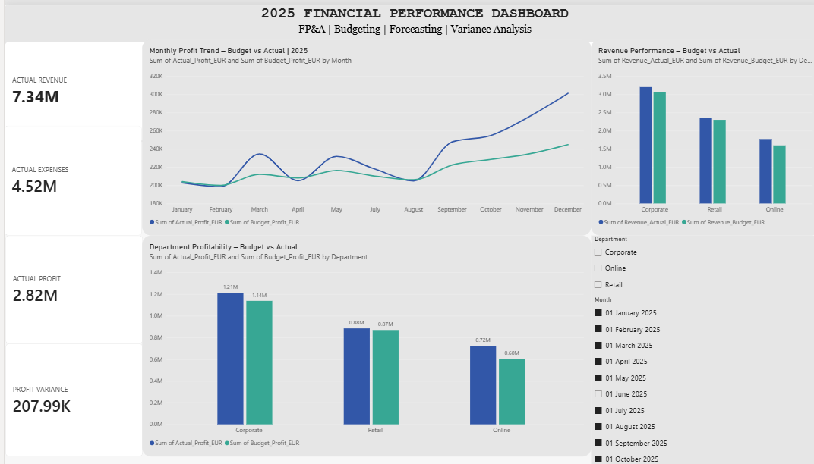

# FP&A Financial Performance Dashboard | 2025

## Project Overview
An end-to-end Financial Planning & Analysis (FP&A) project combining Python and Power BI to analyse financial performance, monitor budgets, and identify business trends.

## Business Objectives
- Monitor actual revenue and expenses against budget.
- Analyse profitability across departments.
- Track monthly profit performance.
- Identify budget variances.
- Present financial insights through an interactive dashboard.

## Tools & Technologies
- Power BI – Dashboard development and visualisation
- Python – Financial data analysis and automation
- Pandas – Data manipulation
- Excel / CSV – Financial data management

## Dashboard Features
- Actual Revenue KPI
- Actual Expenses KPI
- Actual Profit KPI
- Profit Variance KPI
- Monthly Profit: Budget vs Actual
- Department Profitability: Budget vs Actual
- Revenue Performance: Budget vs Actual
- Interactive Department and Month filters

## Project Files
| File | Description |
|---|---|
| FPA_Financial_Performance_Dashboard.pbix | Power BI dashboard |
| fpa_analysis.py | Python analysis script |
| fpa_financial_data_2025.csv | Synthetic financial dataset |

## Key Financial Insights
- Total actual revenue: €7.34M
- Total actual expenses: €4.52M
- Total actual profit: €2.82M
- Positive profit variance: €207.99K

## Data Disclaimer
This project uses synthetic financial data for demonstration and portfolio purposes. It does not contain confidential company information.

## Author
**Naqueeb Mapari**

Finance Professional | FP&A | Business Data Analytics

GitHub: https://github.com/naqueeb-mapari

---

## Dashboard Preview

